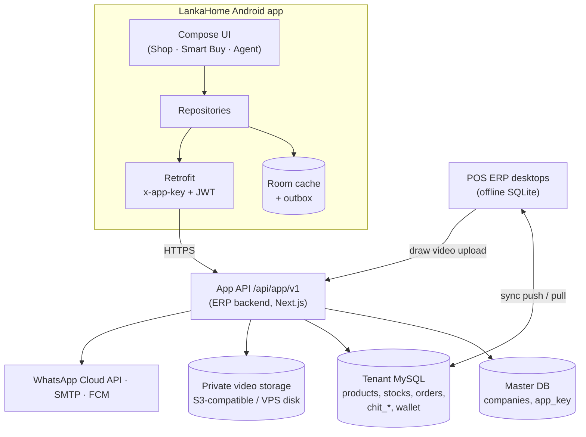

# LankaHome App — Development Architecture Plan

Status: approved concept (26 Oct 2026) + changes agreed 28 Oct 2026. Single company (single tenant) for v1.
Owner: Moni (Pynimox). Read `AGENTS.md` first.

---

## 0. Decisions log

| Date | Decision |
|---|---|
| 26 Oct | One Android app, one login, three role dashboards (Agent, Smart Buy customer, Normal customer). Plan approved. |
| 27 Oct | v1 serves one company. Company connection (backend URL + App Key) is built into the app; users install and use, no setup. |
| 28 Oct | Approved demo UI kept. Two colour themes (Olive & Yellow default, Purple & Pink), user-selectable in Settings. |
| 28 Oct | **No SMS OTP.** Existing customers/agents get User ID + temporary password on WhatsApp. Users may add an email and verify it. |
| 28 Oct | **Offline catalog.** When the server is unreachable the app still shows all products from cache; buying shows a "buy later" message. |
| 28 Oct | **Draw proof video.** Every weekly/monthly draw gets a video; members watch it inside the app only, not shareable. Hosted privately (see §9 — YouTube private cannot do this). |

---

## 1. System overview

- The app never talks to MySQL or to the POS desktop. Only to the App API.
- POS desktops and the app share the same tenant DB, so data written by one appears in the other
  within seconds (desktop sync + app watermark polling + push notifications).

## 2. Components

| Component | Tech | Repo / path |
|---|---|---|
| Android app | Kotlin, Compose, Hilt, Room, Retrofit, WorkManager, Media3, FCM | app repo |
| App API | Next.js 15 route handlers | `erp/backend/app/api/app/v1/` |
| App libs | auth, scoping, wallet, media signing, notify | `erp/backend/lib/app/` (new) |
| POS admin screens | React + Electron IPC | `erp/src/pages/admin/`, `erp/electron/ipc/` |
| Super Admin | App Key + module toggle, WhatsApp/SMTP keys per company | `erp/portals/superadmin/`, `erp/backend/app/api/superadmin/` |
| Storage | S3-compatible bucket (preferred) or VPS disk outside the public uploads dir | VPS / bucket |
| Push | Firebase Cloud Messaging (server key in backend env) | — |

## 3. Accounts & authentication (no SMS)

**Identity:** User ID = mobile number (normalised to `07XXXXXXXX`). Password (bcrypt). Optional email.

### 3.1 Tables (cloud-only)
- `app_users` — id, phone (unique), password_hash, must_change_password, temp_password_expires_at,
  email, email_verified_at, customer_id (nullable → `customers`), agent_id (nullable → `agents`),
  roles (JSON: `customer`, `smartbuy`, `agent`), status (`active` | `locked` | `disabled`),
  failed_logins, last_login_at, created_by_source (`self` | `pos_invite` | `join_approval`), timestamps.
- `app_refresh_tokens` — id, user_id, token_hash, device_id, expires_at, revoked_at.
- `app_devices` — id, user_id, fcm_token, platform, app_version, last_seen_at.
- `app_email_verifications` — id, user_id, email, code_hash, expires_at, used_at.
- `app_credential_dispatches` — id, user_id, channel (`whatsapp_api` | `whatsapp_click`), status,
  provider_message_id, error, sent_by, sent_at (audit of every credential message).

### 3.2 Flows
1. **Existing customers / Smart Buy members / agents (POS invite):**
   POS admin → "App Access" page → select customers or agents (single or bulk, filter: Smart Buy
   members, branch, agent) → **Send app login** → backend creates/updates `app_users`
   (roles from POS data: has `chit_members` row → `smartbuy`; is in `agents` → `agent`), generates a
   temporary password (10 chars, no look-alike characters), `must_change_password = 1`, expiry 7 days,
   and sends a WhatsApp template message: name, User ID (phone), temporary password, app download link.
   - Channel A (preferred): WhatsApp Business Cloud API, approved template `app_login_details`.
   - Channel B (fallback, no API): POS opens WhatsApp click-to-chat with the pre-typed message
     (same pattern as v2.7.28 branch credentials share); staff press send. Bulk = one at a time.
2. **First login:** temp password accepted only before expiry → forced "Set new password" screen →
   optional "Add email" step (skippable).
3. **Self-registration (normal customers):** name, phone, password, optional email. Phone is NOT
   verified (no SMS). Mitigation: first COD order of an unverified account is marked
   `needs_call_confirmation` for the branch; later optional WhatsApp OTP (authentication template).
4. **Email verification (optional):** Profile → add email → 6-digit code via company SMTP
   (`backend/lib/email.ts`), 15-min expiry, 5 tries → `email_verified_at`.
5. **Forgot password:** verified email → reset link/code by email. No verified email → "Request reset"
   → appears in POS "App Access" → admin re-sends a new temporary password on WhatsApp.
6. **Join Smart Buy approved:** the applicant is already logged in → `smartbuy` role added to the same
   account. No new password. WhatsApp + email (if verified) + push "Welcome to Smart Buy".
7. **Tokens:** access JWT 15 min (`portal: 'app'`, `company_id`, `user_id`, `roles`, `customer_id`,
   `agent_id`), refresh 30 days rotating, stored with Tink. Lock account 15 min after 5 failed logins.

## 4. Data model

### 4.1 Existing ERP tables the app reads (confirmed in code)
- Catalog: `products`, `categories`, `stocks`, `discounts`, `coupons`, `installment_plans`, `branches`.
- Orders: `customer_orders`, `customer_order_items`, `deliveries`, `customers`.
- Smart Buy: `chit_schemes` (frequency `monthly` default, can be weekly; `next_draw_date`),
  `chit_members` (`won_cycle_no`, `contributions_paid`, `agent_id`), `chit_draws`
  (`cycle_no`, `draw_date`, `winner_member_id`, `method`), `chit_contributions` (`receipt_number`,
  `collected_by_agent_id`, `status`), `chit_scheme_templates`, `chit_scheme_branches`,
  `smartbuy_wallet` (`balance`), `smartbuy_wallet_transactions` (`transaction_type`, `amount`,
  `balance_after`, `source`, `redemption_id`).
- Agents: `agents` (`code`, `branch_id`), `commission_ledger` (`registration_agent_id`,
  `sales_agent_id`, `total_commission`, `status`), `commission_payouts`, `commission_statement_history`.

### 4.2 New tables

| Table | Synced to POS desktop? | Purpose |
|---|---|---|
| `app_users`, `app_refresh_tokens`, `app_devices`, `app_email_verifications`, `app_credential_dispatches` | No | Auth (§3) |
| `app_password_reset_requests` | **Yes** | Shown in POS "App Access" for admin action |
| `smartbuy_join_requests` | **Yes** | Join flow; POS admin approves/rejects |
| `app_banners` | **Yes** | Banners/ads managed in POS "Online Store" |
| `wishlists` | No | Liked products per user |
| `app_notifications` | No | In-app inbox + push log |
| `stock_reservations` | No | 15-min holds during checkout |
| `draw_proof_videos` | **Yes** (metadata only) | Draw video records (§9) |
| `app_settings` (key/value) | **Yes** | Ordering on/off, maintenance message, delivery fees, min app version |

### 4.3 New columns
- `products`: `is_online`, `slug`, `gallery` (JSON), `short_description`.
- `branches`: `latitude`, `longitude`.
- `customer_orders`: `channel` (`pos` | `app`), `app_user_id`, `assigned_agent_id`, `delivery_fee`,
  `payment_method`, `wallet_amount`, `delivery_otp_hash`, `needs_call_confirmation`.
- `chit_draws`: `proof_video_id`, `proof_published_at`.

All via `ensureTenantCompatibility()`; synced ones also in `ALLOWED_TABLES` + `electron/database.ts`.

## 5. App API (`/api/app/v1`)

Every request: header `x-app-key` (company) + `Authorization: Bearer <jwt>` (except public catalog
and auth). JSON. Errors `{ error: { code, message } }`. Cursor pagination `?cursor=&limit=`.

| Area | Method & path | Auth | Notes |
|---|---|---|---|
| Status | GET `/status` | public | `{ordering_enabled, maintenance_message, min_app_version, server_time}` |
| Watermark | GET `/watermark` | optional | per-table MAX(updated_at) for catalog/orders/wallet/draws |
| Auth | POST `/auth/login`, `/auth/refresh`, `/auth/logout` | — | rate-limited |
| Auth | POST `/auth/register` | — | normal customers |
| Auth | POST `/auth/change-password` | user | clears `must_change_password` |
| Auth | POST `/auth/email/start`, `/auth/email/verify` | user | SMTP code |
| Auth | POST `/auth/forgot` | — | email reset or POS reset request |
| Catalog | GET `/catalog/categories`, `/catalog/products`, `/catalog/products/:id`, `/catalog/banners` | public | `updated_since` delta for cache |
| Wishlist | GET/POST/DELETE `/me/wishlist` | customer | |
| Checkout | POST `/checkout/quote` | customer | server prices, fees, wallet eligibility |
| Checkout | POST `/orders` | customer | idempotency key header; reserves stock; wallet debit if used |
| Orders | GET `/orders`, `/orders/:id` | customer | own orders only |
| Smart Buy | GET `/smartbuy/schemes/open` | public | joinable schemes |
| Smart Buy | POST `/smartbuy/join-requests` | customer | multipart: NIC photos |
| Smart Buy | GET `/smartbuy/me/schemes`, `/me/schemes/:id/statement`, `/me/schemes/:id/draws` | smartbuy | own memberships |
| Smart Buy | GET `/smartbuy/draws/:id/video` | smartbuy (member of scheme) or agent of scheme | returns signed URL, 10-min expiry |
| Wallet | GET `/wallet`, `/wallet/transactions` | smartbuy | |
| Branches | GET `/branches/nearby?lat=&lng=`, `/branches/:id/agents` | customer | |
| Agent | GET `/agent/dashboard`, `/agent/schemes`, `/agent/members`, `/agent/members/:id` | agent | `agent_id` scoped |
| Agent | GET `/agent/commission?month=`, `/agent/commission/statement.pdf` | agent | |
| Agent | GET `/agent/deliveries`, POST `/agent/deliveries/:id/status`, `/agent/deliveries/:id/complete` | agent | complete = OTP + optional photo |
| Agent | GET `/agent/deliveries/:id/bill` | agent | server bill number + ESC/POS-ready lines |
| Devices | POST `/me/devices` | user | FCM token |
| Media | GET `/media/draw-videos/:id?token=` | signed token | HTTP Range streaming, no-store |
| Admin (POS) | POST `/admin/app-access/invite`, `/admin/draw-videos` | company sync key + POS user | called from POS desktop only |

## 6. Key flows

1. **Order:** cart (local) → login → `/checkout/quote` → `/orders` (idempotent) → row in
   `customer_orders` (`channel='app'`) → POS pulls it → admin confirms → assigns agent → push to
   customer + agent.
2. **Delivery:** server generates 4-digit OTP, stores hash on the order, shows OTP to customer in app.
   Agent app receives `delivery_otp_hash` (salted SHA-256) with the delivery so it can verify OTP
   **offline**; completion queued in outbox, server re-verifies on upload.
3. **Bill print:** bill number from server (`/agent/deliveries/:id/bill`) → ESC/POS 58/80 mm over
   Bluetooth; fallback PDF share to WhatsApp.
4. **Draw:** POS conducts draw → `chit_draws` row → POS uploads video → `draw_proof_videos` +
   `chit_draws.proof_video_id` → push "Draw result + video" to scheme members.
5. **Wallet credit:** POS award wizard → wallet credit (server ledger, §10) → push "Rs X credited".

## 7. Offline & cache

Three situations, three behaviours:

| Situation | Detected by | App behaviour |
|---|---|---|
| Phone has no internet | ConnectivityManager | Banner "Offline — showing saved products (updated 2 h ago)". All cached screens work. Buy / Checkout / Wallet pay / Join submit → bottom sheet: "Ippo order panna mudiyaathu. Connection vantha udane notify pannuvom." + **Notify me** + cart is kept. |
| Server unreachable / 5xx / maintenance | API errors, `/status` | Same as above; message from `maintenance_message` when present. |
| Server online, POS desktop offline | (server side) | App works normally. Orders are stored in cloud; the order screen says "Branch will confirm shortly". POS picks them up when back online. |

Implementation:
- Room tables mirror: categories, products (+ stock snapshot, price, discount), banners, branches,
  my orders, my schemes/statement/draws, wallet + transactions, agent schemes/members/deliveries.
- Stale-while-revalidate: UI observes Room `Flow`; repository refreshes on screen open, pull-to-refresh,
  app foreground, and a WorkManager periodic job (every 6 h, unmetered preferred). Delta via
  `updated_since`.
- Images: Coil disk cache 250 MB; product thumbnails prefetched for the first 2 pages of each category.
- Offline prices are labelled "Price may change". Final price always from `/checkout/quote`.
- Outbox table for agent actions (delivery status, completion with OTP) and wishlist toggles;
  WorkManager uploads when online, idempotent event ids.
- "Notify me" = WorkManager one-time job with network constraint → local notification "Ippo order
  pannalaam".
- Orders are **never** queued offline (price/stock can change).

## 8. Live updates & notifications

- App polls `/watermark` every 10 s while a list screen is visible (and on foreground); refreshes only
  changed areas.
- Backend post-commit hook in `applySyncOperation` (sync push from POS) + in App API writes → enqueue
  notification jobs: order status change, delivery assigned, wallet credit/debit, draw result/video
  published, join request approved/rejected, wishlist product price drop/offer (batched daily, max 1/day).
- FCM data messages; in-app inbox in `app_notifications`; per-type toggles in Settings.

## 9. Draw proof video

**Requirement:** every weekly/monthly draw has a video proof; members watch it in the app; nobody can
share it.

**Why not YouTube private (ADR):** a YouTube *private* video plays only for the uploader and up to 50
invited Google accounts — it will not play for app users. *Unlisted* plays in an embed, but anyone who
gets the link can share it, and the YouTube player shows "Watch on YouTube"/share controls that the
YouTube API terms don't allow hiding. So YouTube cannot meet "plays only in our app".

**Design (self-hosted, private):**
1. POS → Smart Buy → Draw detail → **Upload draw video** (MP4, ≤ 300 MB). Electron uploads with the
   company sync key to `POST /api/app/v1/admin/draw-videos` (chunked).
2. Backend stores it in private storage (S3-compatible bucket, or `/data/private-media` on the VPS —
   NOT the public `UPLOAD_DIR`), transcodes to 720p H.264 with ffmpeg (faststart), writes
   `draw_proof_videos` (id, draw_id, scheme_id, storage_key, duration_sec, size_bytes, status
   `processing|ready|failed`, uploaded_by, created_at) and sets `chit_draws.proof_video_id`.
3. App: Draws → winner card → **Watch draw video** → `GET /smartbuy/draws/:id/video` (server checks the
   user is a member of that scheme, or its agent) → signed URL (HMAC, user-bound, 10-min expiry) →
   `GET /media/draw-videos/:id?token=` streams with Range, `Cache-Control: no-store`.
4. Player screen: Media3 ExoPlayer, no share/download buttons, `WindowManager.LayoutParams.FLAG_SECURE`
   (blocks screenshots and screen recording), no ExoPlayer disk cache for this media, small watermark
   overlay with the viewer's member number (deters camera recording of the screen, which no app can
   fully prevent).
5. Optional legacy field `external_url` kept for an unlisted YouTube link only if Moni accepts the
   sharing risk; off by default.

Storage estimate: a 3-minute 720p draw video ≈ 30–60 MB.

## 10. Wallet consistency (critical fix before wallet checkout ships)

Found in code: the POS desktop debits `smartbuy_wallet.balance` locally
(`electron/services/smartbuyWallet.ts`) and syncs the whole row with the new absolute `balance`. The
cloud then applies last-write-wins. If the app debits in the cloud while a POS spends the same wallet
(especially offline), one debit overwrites the other → double spend.

Fix (choose before Phase 3, default = A):
- **A. Ledger-authoritative balance.** `smartbuy_wallet_transactions` is the source of truth. On sync
  push of a wallet row, the server ignores the incoming absolute `balance` and recomputes
  `balance = SUM(credits) − SUM(debits)` inside a transaction with `SELECT … FOR UPDATE`; a debit that
  would make it negative is rejected and flagged for review. Same pattern as the existing stock
  delta-merge (`_base_stock`).
- **B. Online-only wallet redemption at POS.** POS wallet payment requires a live server call
  (`/admin/wallet/debit`); no offline wallet spends.
App wallet checkout always goes through the server, with an idempotency key.

## 11. UI & themes

- Keep the approved demo layout. Fix: header gap, truncated titles, clipped role chip/badge,
  "Paid" → "Active" badge on the scheme card.
- Themes: `OliveYellow` (primary `#5A6B2E`, container `#E9EDD8`, accent `#F2C230` with dark text) and
  `PurplePink` (primary `#6B3FA0`, container `#EFE6F8`, accent `#C93A78` with white text). Fixed:
  success `#16A34A`, warning `#D97706`, error `#DC2626`. Stored in DataStore, applied instantly.
- Languages: English, Tamil, Sinhala via string resources.
- Accessibility: 48 dp touch targets, contrast AA, TalkBack labels on icons.

## 12. Security checklist

- No sync key in APK; `x-app-key` is rotatable from Super Admin.
- Server-side scoping for every query (role + owner id); tests for cross-user access.
- bcrypt passwords, temp passwords expire, lockout, rate limits on auth and checkout.
- Masked winner names (`K. Ra… · Member #12`) for other members.
- NIC photos stored privately, visible only to POS admins; deleted 90 days after a rejected request.
- `FLAG_SECURE` on draw video, wallet and NIC screens.
- HTTPS only; certificate pinning optional in v2. ProGuard/R8 on release.
- Audit log rows for invites, password resets, wallet movements, video uploads.

## 13. POS ERP desktop changes

| Screen | Purpose |
|---|---|
| App Access | Invite customers/agents (WhatsApp credentials), see dispatch status, handle reset requests, disable accounts |
| App Join Requests | Review NIC/details, approve/reject with reason |
| Online Store | Banners, featured/online products, delivery fees, ordering on/off, maintenance message |
| Orders (existing) | Show `channel=app` badge, assign agent, call-confirm flag |
| Smart Buy → Draw detail | Upload draw video, see processing status |
| Settings → WhatsApp | Cloud API phone number id + token (already in `whatsappService.ts`), template names |

## 14. Roadmap (each phase ends with its gate)

| Phase | Scope | Gate |
|---|---|---|
| 0 Foundation | App Key + module in Super Admin; `app_users` + auth API; WhatsApp credentials (Channel B first, A when templates approved); email verify; app session, theme system, Room setup, `/status` + `/watermark` | Test tenant: invite → WhatsApp → first login → password change works; other tenants' data unreachable |
| 1 Shop | Catalog API + cache, offline banner & buy-later sheet, wishlist, cart, checkout quote, orders, POS Online Store + order badge | First real app order confirmed in POS and delivered |
| 2 Agent | Agent dashboard, members, commission, deliveries with offline OTP, bill print (Bluetooth + PDF) | Agents complete all app orders through the app for one week |
| 3 Smart Buy | Wallet consistency fix (§10), statement, draws, draw video upload + secure player, wallet, wallet checkout, join flow + POS Join Requests | Draw → video → wallet credit → wallet purchase works end to end on test tenant |
| 4 Polish & scale | Price-drop notifications, Tamil/Sinhala, analytics, Play Store release, iOS later, multi-company later | Play Store production release |

## 15. Testing

- Backend: route tests for every endpoint: happy path, wrong role, other user's id, no token, expired
  token, rate limit. Wallet: concurrent debit test (2 parallel requests on a balance that covers one).
- App: unit tests for repositories/viewmodels (fake API + in-memory Room); Compose UI tests for login,
  checkout, offline sheet, theme switch; manual matrix: 3 roles × 2 themes × online/offline.
- Device: `Pixel_6` emulator + one low-end real phone (2–3 GB RAM, Android 10).

## 16. Environments & release

- `dev` (local backend + test tenant), `staging` (VPS, test tenant), `prod` (VPS, real company).
- Build config per environment: `API_BASE_URL`, `APP_KEY` in `local.properties`/secrets plugin, never
  committed.
- Backend deploy: existing GitHub Actions → VPS flow; deploy backend before the app version that
  needs it.
- App: debug APK for demos (`preview.bat`), signed release AAB for Play Store (Phase 4).

## 17. Open decisions

- [ ] WhatsApp Channel A (Cloud API, needs Meta Business verification + template approval) or B only for launch?
- [ ] Wallet fix A or B (§10)?
- [ ] Video storage: S3-compatible bucket (which provider) or VPS disk?
- [ ] Do agents collect monthly cash from members (adds collection + receipt feature)?
- [ ] Wallet usable for delivery fee? Wallet expiry?
- [ ] Online stock source: chosen branch or all branches?
- [ ] Delivery fee model: flat / distance / zone?
- [ ] Legal opinion on the Smart Buy scheme.
