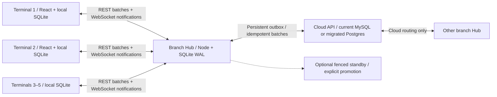

# Local-first POS audit and implementation status

Date: 2026-11-22. Active project: `erp/`, selected by the root package scripts.
The sibling release and deployment directories have not been modified.

Stage 2 now adds a runnable Node Branch Hub, terminal-local hold outbox, shared
numbered holds, replay-safe exclusive recall, status UI and verified backups.
See [Branch Hub setup and recovery](BRANCH_HUB_SETUP.md) for the current install
guide, actual protocol and important partition/recovery limits. The initial
audit below describes the system before these additions. Billing/stock cloud
cutover remains outstanding.

Cashier-numbering update (2026-11-23): F4 now asks for the cashier's number;
F5 accepts that same number. Numbers stay unchanged through Hub sync and can
be reused after recall. Duplicate active numbers are rejected, including atomic
Hub checks. Offline collisions preserve the local cart for recovery/renumbering.
Unconfigured terminals use a separate numbered-hold sidecar; the POS database
schema and historical held carts are retained.
Validation: all 209 unit tests passed, including the full cashier-page F4/F5
keyboard-flow test. The 91 focused legacy synchronization/IPC regression tests
also passed. All 18 focused Hub/local-hold integration
tests passed, including number reuse and offline duplicate recovery.

Stage 2 verification: 205 unit tests passed; the full SQLite integration run
passed 280 tests with 23 skipped (including the then-current 13 Hub tests).
The final focused Hub run passed 15 tests after two extra replay/input tests
were added. TypeScript checking, the renderer build and standalone Node Hub
build passed. The standalone runtime smoke test passed against its own driver.

## Initial audit (before the Hub implementation)

The desktop app uses Electron 33, React 18, Zustand, TypeScript and better-sqlite3.
The existing server is Next.js 15 with MySQL (`backend/package.json`), rather than
Express/Postgres. Replacing the server/database is a separate migration, not a
configuration change.

| Area | Evidence and consequence |
| --- | --- |
| Billing | `electron/ipc/invoices.ts` commits to local SQLite. Reuse this implementation. Sync records are queued after transaction completion in several paths; a crash between commit and queue insertion requires reconciliation. |
| Search | `ProductSearch.tsx` previously debounced 150 ms, then called SQLite through IPC for each query. Search-field Enter used a separate exact-code path, bypassing the highlighted suggestion. Both paths have been addressed below. |
| Stock | `stockMovement.ts` already records movements, but `stockSync.ts` also queues absolute `stocks` rows. Movement audit records alone do not make synchronization event-sourced. |
| Holds | `holds.ts` stores local `held_carts`, queues them for cloud sync and deletes on recall. Two terminals with independent databases cannot use this as a branch-wide exclusive claim. |
| Payments | Existing payments, coupons, wallets, installment handling and asynchronous printing should be reused. Paid invoice edit/convert/cancel handlers still update invoice rows; immutable financial events are not implemented by this change. |
| Branches | Existing role and branch filters must remain authoritative. Branch-scoped catalog snapshots are discarded immediately when branch changes. |
| Network | Current sync is terminal-to-cloud. No branch Hub, LAN heartbeat, shared sequence allocator, failover fencing, or Hub status exists in this patch. |
| Numbering | Existing invoice numbering remains unchanged. It must be audited and migrated before independent terminals can be certified collision-free offline. |
| UI | The whole cart store is subscribed to by several components. Full catalog grid and cart virtualization remain outstanding. |

This was a review of the relevant billing, product, stock, holds, sync, database,
backup and server entry points; it is not an assertion that every source file has
received a line-by-line audit.

## Implemented changes

- `src/lib/posCatalog.ts`: immutable in-memory catalog with exact SKU/barcode maps,
  token prefix postings and trigram postings for fuzzy fallback. Exact codes keep
  leading zeroes. Search returns at most 30 rows and performs no IPC/network work.
- `src/hooks/usePosCatalog.ts`: load active products from existing local SQLite
  through IPC when cashier opens; refresh after cloud data-change notifications,
  focus, successful payment and every 60 seconds. Failed refresh retains the last
  successful snapshot. Cleanup prevents stale branch responses from replacing it.
  This is a full local snapshot refresh, **not versioned incremental sync**.
- `ProductSearch.tsx`: removed debounce and per-query IPC. Search input owns
  Up/Down/Enter; Enter accepts the highlighted item. Other inputs cannot trigger
  product selection. Rows show unit, price and stock.
- `posQuantity.ts` and `POSPage.tsx`: `5*item`, measured-item quantity dialog,
  decimals and compatible g/kg, ml/l and mm/cm/m conversion. F3 edits the last line
  through the same dialog. Variant line deletion and quantity adjustment use the
  variant key rather than the base product key.
- F2 search, F3 last quantity, F4 hold, F5 resume, F6 discount, F8 payment,
  F9 cash and F10 card in payment. F10 can open card payment directly. Page
  shortcuts are disabled behind cashier dialogs. Escape works inside inputs.
- Held bill list supports arrows, Enter and Escape. Existing storage/recall
  semantics are preserved; this does **not** implement cross-terminal locking.
- Empty cash tender is treated as the exact remaining amount.

Existing POS database schema, financial numbering and production data are untouched.
The optional Hub and terminal sidecar use their own new schema files.
No database migration has been run or added to application startup.
Existing unrelated purchase-order changes in the workspace are preserved.

## Verification

Commands, from `erp/` on Windows:

```powershell
npm.cmd run test:unit -- --reporter=dot
npm.cmd run typecheck
npm.cmd run test:integration -- --reporter=dot
node scripts/pos-load-test.cjs
```

Baseline: 180 unit tests passed. Final verification: 199 unit tests passed;
267 SQLite integration tests passed and 23 were skipped; TypeScript checking
and the production renderer build passed. Some existing integration diagnostics
log SmartBuy findings and a `credit_ledger` backfill warning despite a passing
test result; these are not a clean production-readiness sign-off.
Added tests cover exact/prefix/fuzzy matching,
inactive catalog replacement, keyboard suggestion selection, keyboard event
isolation, unit validation/conversion, branch snapshot isolation and failed
offline refresh. Unit/component tests do not constitute an Electron end-to-end
keyboard acceptance test.

CPU load script: 12,000 products, 250 simulated bills, 30 lines per bill. On this
machine one run measured search p99 5.89 ms (maximum 15.50 ms), cart mutation p99
0.060 ms, catalog construction 358 ms. The script exits nonzero if search p99 is
at least 10 ms or cart mutation p99 is at least 50 ms. It deliberately reports
maximum latency too. Hardware, GC and scheduling can create larger outliers.

This script measures the actual catalog and Zustand cart functions. It does not
measure React painting, SQLite payment commit, print completion or sustained
wall-clock traffic. The <200 ms payment target and the complete 200 bills/hour
per-terminal acceptance target remain unverified.

## Target architecture — not yet implemented



Cashier commits bill, payment, stock events, sequence increment and terminal
outbox rows in one local transaction. Only after successful local commit may the
UI clear the bill. Printing uses a separate durable job queue. Stock events and
their cached local balance update belong in the same transaction: asynchronously
deferring the balance update would let a second sale validate stale stock.

Network synchronization and physical printing run outside the payment request.
Persisting the outbox is essential billing work; it must not be deferred to a
best-effort promise after the bill commit.

The Hub is the shared branch authority while reachable, but each terminal always
allocates its own bill prefix and monotonically increasing local sequence. A Hub
outage cannot produce a shared short hold number or safely acquire a shared lock;
fallback holds must retain a terminal prefix until acknowledged by the Hub.

## Planned additive schema and migration boundary

The following is a design contract, not an executable migration:

| Table | Keys and purpose |
| --- | --- |
| `terminal_identity` | Singleton branch UUID/code, terminal UUID/code, next sequence. Enroll and lock identity before first payment. |
| `financial_events` | UUID primary key, branch, terminal, local sequence, bill UUID, kind, immutable payload/hash, timestamp. Unique `(branch_id, terminal_id, sequence)`. |
| `inventory_events` | UUID primary key, branch, product, variant, signed delta, financial/purchase reference, timestamp; index `(branch_id, product_id, variant_id)`. |
| `inventory_balances` | Branch/product/variant primary key, computed quantity and last applied event cursor. Rebuildable from opening and delta events. |
| `transport_outbox` | UUID primary key, destination, event UUID, immutable payload/hash, attempts, next retry time, acknowledgement; unique `(destination, event_id)` and index `(acknowledged_at, next_retry_at)`. |
| `transport_inbox` | Source/event UUID primary key plus payload hash and result. Commit deduplication and application in one transaction. |
| `master_changes` | Monotonic sequence primary key; entity, UUID, version, tombstone, payload. Index `(sequence)`; versions generated by master, never terminal clocks. |
| `hold_records` | UUID, branch/day/number unique, payload, state, owner terminal, lease token/expiry and version. Retain consumed tombstones. |
| `hold_day_sequences` | Branch and local business date primary key, next number, transactionally allocated. |
| `print_jobs` | UUID, bill UUID, document type, payload, attempts, next attempt, status. Reprints are explicit new requests. |

Before a financial migration: use the existing SQLite online-backup facility,
verify integrity, record row counts and checksums, export numbering/identity
settings and retain an untouched backup. Introduce new tables alongside existing
ones. Generate exactly one opening stock event per balance snapshot using a
stable migration ID; do not replay historical movements on top of an opening
balance. Verify totals, returns, batch allocations, receivables, coupons and
wallets in a copied workspace. Rehearse rollback. Ask the owner before any
destructive migration or replacing production databases.

Bill numbers must be `BRANCH-TERMINAL-SEQUENCE`; UUIDs remain the internal keys.
Restoring a terminal backup can roll sequences backwards: re-enroll it with a
new terminal identity, or recover the acknowledged sequence high-water mark
before enabling new payments. Never clone one terminal identity onto two PCs.

## Planned synchronization protocol

1. Enroll terminal against one branch; authenticate with a per-device credential.
   Never trust a branch ID supplied in an arbitrary event payload.
2. `POST /v1/events`: bounded batch of `{event_id, terminal_id, sequence, type,
   schema_version, payload, payload_hash}`. Hub authenticates branch scope,
   validates the entire event and commits inbox, bill/event records, stock cache
   changes and cloud outbox atomically. Same ID and same payload returns the
   original acknowledgement; same ID with different payload is rejected.
3. Acknowledge individual committed event IDs only. A lost acknowledgement
   causes retry of exactly the same event, never regeneration of a new UUID.
   Retain failed/dead-letter events visibly for operator intervention.
4. `GET /v1/changes?after=<cursor>&limit=500`: master changes and tombstones in
   strict cursor order. Advance the stored cursor only in the transaction that
   applies all returned changes. Timestamp-only `updated_since` is insufficient
   for tied timestamps; support a stable sequence or `(timestamp, UUID)` cursor.
5. WebSocket sends heartbeat and latest cursor notifications; REST replay is
   authoritative. Reconnect with capped exponential backoff and jitter. Never
   block billing on heartbeat, discovery, a sync batch or DNS.
6. Hub cloud worker uses the same durable inbox/outbox rules and bounded batches.
   Cloud routes changes to other branches; terminals never talk to another
   branch Hub. Cloud Online means a successful authenticated cloud heartbeat,
   not `navigator.onLine`.
7. Holds: Hub transaction allocates `H-01` etc using branch business timezone;
   acquire uses atomic compare-and-set on available state and returns a lease
   token. Confirm recall consumes only that token. Expired leases can be claimed
   again. Offline terminals may only resume their own locally stored fallback
   holds. A terminal cannot claim an unseen shared hold while partitioned.
8. Use return/void events referencing the original immutable bill. Do not sync
   absolute stock quantities as concurrent authoritative writes after cutover.

## Branch deployment, backup and restore

The runnable Hub and terminal hold setup is documented in
[BRANCH_HUB_SETUP.md](BRANCH_HUB_SETUP.md). It includes separate Node/Electron
native dependencies, random per-terminal enrollment files, reserved LAN IP,
authenticated REST/WebSocket heartbeat, daily verified Hub backups and restore
reconciliation. It has been tested on loopback, not deployed to a real branch.

## Outstanding delivery work

Production service installer and real-branch provisioning; financial terminal
transport integration; cloud protocol and any Postgres migration; transactional financial outbox; immutable paid bills; event
stock cutover and reconciliation; durable print queue; identity enrollment and
number migration; durable active-cart recovery after acknowledged recall; incremental catalog versions;
configurable shortcuts and Ctrl+P last-bill reprint; full split cash/card loop;
combined financial queue/Cloud indicators; virtualization; optional safe
failover; production financial cutover/outage integration tests; full
Electron keyboard end-to-end test; sustained payment latency/load measurements.

Until these are implemented and verified, this change must not be described as
the complete requested branch-offline architecture or rush-hour certification.
