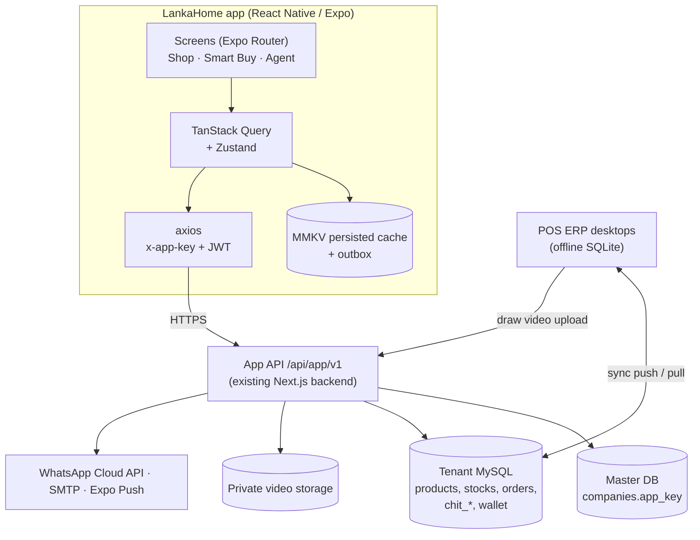

# LankaHome App — Development Architecture Plan

Status: approved concept (26 Oct 2026) + changes agreed 28 Oct 2026. Single company (single tenant) for v1.
Owner: Moni (Pynimox). Read `AGENTS.md` first.

---

## 0. Decisions log

| Date | Decision |
|---|---|
| 26 Oct | One mobile app, one login, three role dashboards (Agent, Smart Buy customer, Normal customer). Plan approved. |
| 27 Oct | v1 serves one company. Company connection (backend URL + App Key) is built into the app; users install and use, no setup. |
| 28 Oct | Approved demo UI kept (AI Studio Kotlin prototype = design reference only). Two colour themes (Olive & Yellow default, Purple & Pink), user-selectable in Settings. |
| 28 Oct | **No SMS OTP.** Existing customers/agents get User ID + temporary password on WhatsApp. Users may add an email and verify it. |
| 28 Oct | **Offline catalog.** When the server is unreachable the app still shows all products from cache; buying shows a "buy later" message. |
| 28 Oct | **Draw proof video.** Every weekly/monthly draw gets a video; members watch it inside the app only, not shareable. Hosted privately (§9 — YouTube private cannot do this). |
| 28 Oct | **App = React Native (Expo, TypeScript)**, built inside the POS ERP repo at `mobile/`. **Backend stays the existing Next.js API** (`backend/`), extended with `/api/app/v1`. Existing DB tables are reused; only additive tables/columns. |
| 28 Oct | **System notifications** shown on the phone outside the app (tray, lock screen, sound), even when the app is closed (§8.1). |
| 28 Oct | **In-app updates** like the POS desktop auto-updater: JS updates download silently; new native versions prompt inside the app; old versions are forced to update (§8.2). |
| 28 Oct | **Order/product tracking** plus every standard e-commerce feature customers expect (§11.1). App must stay simple, lightweight and smooth with a written performance budget (§11.2). |
| 7 Nov | **Approved UI = web demo** https://mobile-app-demo-jet.vercel.app/ (repo `Monishan2003/mobile-app-demo`). App name **Natural Plantation**. Login field accepts mobile number, Smart Buy member number or agent code. Agents collect scheme payments + COD cash (pending until verified in POS). |
| 7 Nov | **Play Store:** plan to publish as an update to the old "Natural Farming" listing (same package name + upload key, higher versionCode). Package name is read from `ANDROID_PACKAGE`; Moni to confirm the exact package from Play Console. Build kickoff: `docs/mobile-app/CLAUDE_CODE_KICKOFF.md`. |

---

## 1. System overview

- The app never talks to MySQL or to the POS desktop. Only to the App API.
- POS desktops and the app share the same tenant DB: data written by one appears in the other within
  seconds (desktop sync + app watermark polling + push notifications).

## 2. Components & repo layout

| Component | Tech | Path in ERP repo |
|---|---|---|
| Mobile app | Expo + React Native + TypeScript | `mobile/` |
| API contracts (shared types) | TypeScript, type-only | `backend/lib/app/contracts/` |
| App API | Next.js 15 route handlers | `backend/app/api/app/v1/` |
| App server libs | auth/context, scoping, wallet, media signing, notify, whatsapp | `backend/lib/app/` |
| POS admin screens | React + Electron IPC | `src/pages/admin/`, `electron/ipc/` |
| Super Admin | App Key + module toggle, WhatsApp/SMTP keys | `portals/superadmin/`, `backend/app/api/superadmin/` |
| Storage | S3-compatible private bucket (preferred) or VPS disk outside the public uploads dir | VPS / bucket |

Repo hygiene:
- `mobile/` has its own `package.json`, `tsconfig.json` (path `@contracts/*` → `../backend/lib/app/contracts/*`),
  `.gitignore` (`node_modules`, `.expo`, `android/`, `ios/` when using prebuild, `.env*`).
- Root `tsconfig.json`, `vitest.workspace.ts` and electron-builder only include `src/`, `electron/`,
  `dist*` — `mobile/` does not affect the desktop build.
- Add `paths-ignore: ['mobile/**', 'docs/**']` under `on.push` in `.github/workflows/deploy-vps.yml`.
- Branches: `feature/mobile-app-*`. Merge to `main` only after the phase gate (main = production deploy).

## 3. Accounts & authentication (no SMS)

**Identity:** User ID = mobile number (normalised `07XXXXXXXX`). Password (bcrypt). Optional email.

### 3.1 Tables (cloud-only)
- `app_users` — id, phone (unique), password_hash, must_change_password, temp_password_expires_at,
  email, email_verified_at, phone_verified, customer_id (→ `customers`), agent_id (→ `agents`),
  roles (JSON: `customer`, `smartbuy`, `agent`), status (`active`|`locked`|`disabled`), failed_logins,
  locked_until, last_login_at, created_by_source (`self`|`pos_invite`|`join_approval`), timestamps.
- `app_refresh_tokens` — id, user_id, token_hash, device_id, expires_at, revoked_at.
- `app_devices` — id, user_id, expo_push_token, platform, app_version, last_seen_at.
- `app_email_verifications` — id, user_id, email, code_hash, attempts, expires_at, used_at.
- `app_credential_dispatches` — id, user_id, channel (`whatsapp_api`|`whatsapp_click`), status,
  provider_message_id, error, sent_by, sent_at.

### 3.2 Flows
1. **POS invite (existing customers, Smart Buy members, agents):** POS "App Access" → select (bulk ok)
   → backend upserts `app_users` (roles from data: `chit_members` → smartbuy, `agents` → agent),
   temporary password (10 chars, no look-alikes), `must_change_password = 1`, expiry 7 days →
   WhatsApp message with name, User ID, temp password, download link.
   Channel A: WhatsApp Business Cloud API template. Channel B (fallback): POS opens click-to-chat
   with the pre-typed message, staff press send (same as v2.7.28 branch share).
2. **First login:** temp password → forced Set Password → optional Add Email.
3. **Self-registration (normal customers):** name, phone, password, optional email;
   `phone_verified = false`; first COD order → `needs_call_confirmation`.
4. **Email verification:** 6-digit code via company SMTP (`backend/lib/email.ts`), 15 min, 5 tries.
5. **Forgot password:** verified email → email code. Otherwise → `app_password_reset_requests` (synced)
   → POS App Access → admin re-sends a temp password on WhatsApp.
6. **Join Smart Buy approved:** `smartbuy` role added to the same account; WhatsApp + email + push.
7. **Tokens:** access JWT 15 min (`portal: 'app'`, `company_id`, `user_id`, `roles`, `customer_id`,
   `agent_id`), refresh 30 days rotating, stored in `expo-secure-store`. Lock 15 min after 5 failures.

## 4. Data model

### 4.1 Existing ERP tables the app reads (confirmed in code)
- Catalog: `products`, `categories`, `stocks`, `discounts`, `coupons`, `installment_plans`, `branches`.
- Orders: `customer_orders`, `customer_order_items`, `deliveries`, `customers`.
- Smart Buy: `chit_schemes` (`frequency` monthly/weekly, `next_draw_date`, `agent_id`),
  `chit_members` (`won_cycle_no`, `contributions_paid`, `agent_id`), `chit_draws` (`cycle_no`,
  `draw_date`, `winner_member_id`, `method`), `chit_contributions` (`receipt_number`,
  `collected_by_agent_id`, `status`), `chit_scheme_templates`, `chit_scheme_branches`,
  `smartbuy_wallet` (`balance`), `smartbuy_wallet_transactions` (`transaction_type`, `amount`,
  `balance_after`, `source`, `redemption_id`, `invoice_id`).
- Agents: `agents` (`code`, `branch_id`), `commission_ledger` (`registration_agent_id`,
  `sales_agent_id`, `total_commission`, `status`), `commission_payouts`, `commission_statement_history`.
- Variants (v2.8.5+): `product_variants`, `product_variant_stocks`, `product_attributes`,
  `product_attribute_values`; `invoice_items.variant_id`, `stock_movements.variant_id`.
- Smart Buy (v2.8.3–2.8.4): weekly payment frequency (`chit_scheme_templates.frequency` default
  `weekly`), customer capacity, winner settlement. Draws can be weekly or monthly.
- Business type (v2.8.0+): Supermarket/Food City companies hide Smart Buy and Installments. The app must
  read the company's enabled modules and hide those tabs too.

**Sync gap found (28 Oct, v2.8.8):** the desktop pulls `product_variants`, `product_variant_stocks`,
`product_attributes`, `product_attribute_values`, but they are not in the backend `ALLOWED_TABLES`
(`backend/lib/sync.ts`) and no desktop push enqueue for them was found. So variants likely never reach
the cloud, and the app can't show them. Phase 1 task: add them to `ALLOWED_TABLES` (+ `RELATED_KEYS`
for `product_id`), enqueue variant writes on the desktop, verify desktop → cloud → second desktop.

### 4.2 New tables

| Table | Synced to POS desktop? | Purpose |
|---|---|---|
| `app_users`, `app_refresh_tokens`, `app_devices`, `app_email_verifications`, `app_credential_dispatches` | No | Auth (§3) |
| `app_password_reset_requests` | **Yes** | Shown in POS App Access |
| `smartbuy_join_requests` | **Yes** | Join flow; POS admin approves/rejects |
| `app_banners` | **Yes** | Banners/ads managed in POS Online Store |
| `wishlists` | No | Liked products |
| `app_notifications` | No | In-app inbox + push log |
| `stock_reservations` | No | 15-min holds during checkout |
| `draw_proof_videos` | **Yes** (metadata) | Draw videos (§9) |
| `app_settings` (key/value) | **Yes** | Ordering on/off, maintenance message, delivery fees, min app version |
| `app_request_receipts` | No | Idempotency keys for orders/wallet |

### 4.3 New columns on existing tables
- `products`: `is_online`, `slug`, `gallery` (JSON), `short_description`.
- `branches`: `latitude`, `longitude`.
- `customer_orders`: `channel` (`pos`|`app`), `app_user_id`, `assigned_agent_id`, `delivery_fee`,
  `payment_method`, `wallet_amount`, `delivery_otp_hash`, `needs_call_confirmation`.
- `chit_draws`: `proof_video_id`, `proof_published_at`.
- `companies` (master DB): `app_key`, `previous_app_key`, `previous_app_key_expires_at`.

All tenant changes via `ensureTenantCompatibility()`; synced ones also in `ALLOWED_TABLES` + `electron/database.ts`.

## 5. App API (`/api/app/v1`)

Headers: `x-app-key` (company) + `Authorization: Bearer <jwt>` (except public catalog/auth).
Errors `{ error: { code, message } }`. Cursor pagination. Every request/response type is declared in
`backend/lib/app/contracts/` and used by both the route and the app.

| Area | Method & path | Auth | Notes |
|---|---|---|---|
| Status | GET `/status` | public | `{ordering_enabled, maintenance_message, min_app_version, server_time}` |
| Watermark | GET `/watermark` | optional | per-area MAX(updated_at) |
| Auth | POST `/auth/login`, `/auth/refresh`, `/auth/logout`, `/auth/register` | — | rate-limited |
| Auth | POST `/auth/change-password`, `/auth/email/start`, `/auth/email/verify`, `/auth/forgot` | user/— | |
| Catalog | GET `/catalog/categories`, `/catalog/products`, `/catalog/products/:id`, `/catalog/banners` | public | `updated_since` delta |
| Wishlist | GET/POST/DELETE `/me/wishlist` | customer | |
| Checkout | POST `/checkout/quote` | customer | server prices, fees, wallet eligibility |
| Orders | POST `/orders` (Idempotency-Key), GET `/orders`, `/orders/:id` | customer | own orders only |
| Smart Buy | GET `/smartbuy/schemes/open`; POST `/smartbuy/join-requests` (multipart NIC photos) | public/customer | |
| Smart Buy | GET `/smartbuy/me/schemes`, `/me/schemes/:id/statement`, `/me/schemes/:id/draws` | smartbuy | |
| Smart Buy | GET `/smartbuy/draws/:id/video` | member of scheme / scheme agent | signed URL, 10 min |
| Wallet | GET `/wallet`, `/wallet/transactions` | smartbuy | |
| Branches | GET `/branches/nearby?lat=&lng=`, `/branches/:id/agents` | customer | |
| Agent | GET `/agent/dashboard`, `/agent/schemes`, `/agent/members`, `/agent/members/:id` | agent | `agent_id` scoped |
| Agent | GET `/agent/commission?month=`, `/agent/commission/statement.pdf` | agent | |
| Agent | GET `/agent/deliveries`; POST `/agent/deliveries/:id/status`, `/agent/deliveries/:id/complete` | agent | complete = OTP + optional photo |
| Agent | GET `/agent/deliveries/:id/bill` | agent | server bill no. + printable lines |
| Devices | POST `/me/devices` | user | Expo push token |
| Notifications | GET `/me/notifications`, POST `/me/notifications/read`, GET/PUT `/me/notification-settings` | user | inbox + per-type toggles |
| Orders | POST `/orders/:id/cancel` (before dispatch), GET `/orders/:id/tracking`, GET `/orders/:id/invoice.pdf` | customer | timeline, agent, ETA |
| After sales | POST `/orders/:id/return-requests`, POST `/orders/:id/reviews` | customer | Phase 4 |
| Addresses | GET/POST/PUT/DELETE `/me/addresses` | customer | |
| Account | DELETE `/me` | user | account deletion (Play policy) |
| Search | GET `/catalog/search?q=` , `/catalog/suggest?q=` | public | |
| Media | GET `/media/draw-videos/:id?token=` | signed token | Range streaming, no-store |
| Admin (POS only) | POST `/admin/app-access/invite`, `/admin/draw-videos` | company sync key + POS user | called from the Electron main process |

## 6. Key flows

1. **Order:** cart (local, Zustand) → login → `/checkout/quote` → `/orders` (idempotent) →
   `customer_orders` (`channel='app'`) → POS pulls → admin confirms → assigns agent → push to customer + agent.
2. **Delivery:** server generates a 4-digit OTP, stores its hash, shows the OTP to the customer.
   The agent's delivery payload carries `delivery_otp_hash` (salted SHA-256) so the app can verify the OTP
   offline; completion goes to the outbox and the server re-verifies on upload.
3. **Bill print:** bill number from `/agent/deliveries/:id/bill` → ESC/POS 58/80 mm over Bluetooth;
   fallback `expo-print` PDF → `expo-sharing` to WhatsApp.
4. **Draw:** POS conducts draw → `chit_draws` → POS uploads video → `draw_proof_videos` +
   `chit_draws.proof_video_id` → push to scheme members.
5. **Wallet credit:** POS award wizard → server ledger credit (§10) → push "Rs X credited".

## 7. Offline & cache

| Situation | Detected by | App behaviour |
|---|---|---|
| Phone has no internet | NetInfo | Banner "Offline — showing saved products (updated 2 h ago)". Cached screens work. Buy / Checkout / Wallet pay / Join submit → buy-later sheet: "Ippo order panna mudiyaathu. Connection vantha udane notify pannuvom." + **Notify me**; cart kept. |
| Server unreachable / 5xx / maintenance | axios errors, `/status` | Same as above, with `maintenance_message` when present. |
| Server online, POS desktop offline | (server side) | App works normally; orders stored in cloud; order screen says "Branch will confirm shortly". |

Implementation:
- TanStack Query with `persistQueryClient` + MMKV persister: `gcTime` 7 days for catalog queries,
  `networkMode: 'offlineFirst'`, `onlineManager` wired to NetInfo, `focusManager` to AppState.
- Catalog is fetched as a full snapshot on first run (~1,600 products), then deltas via `updated_since`.
- `expo-image` with `cachePolicy="disk"`; prefetch thumbnails of the first 2 pages per category.
- Offline prices are labelled "Price may change"; the final price always comes from `/checkout/quote`.
- Outbox (Zustand + MMKV) only for agent delivery status/completion and wishlist toggles; flushed when
  NetInfo reports online, event UUID = idempotency key. Orders are never queued offline.
- "Notify me": remember the request; on reconnect (NetInfo listener) show a local notification via
  `expo-notifications`. If the app was killed, the next app open handles it.

## 8. Live updates, notifications & app updates

- `/watermark` polled every 10 s while a list screen is focused; invalidate only the changed query keys.
- Backend hooks after sync push (`applySyncOperation` commit) and after App API writes → notification jobs.

### 8.1 Push notifications (outside the app)
Notifications appear in the phone's notification tray / lock screen with sound, even when the app is
closed or killed — like WhatsApp or Daraz.

- Delivery: `expo-notifications` + FCM on Android (needs a Firebase project and `google-services.json`;
  the backend sends through the Expo Push API using the Expo push token, or directly to FCM HTTP v1).
- Permission: ask on Android 13+ (`POST_NOTIFICATIONS`) after login with a short explainer screen,
  not on first launch.
- Android notification channels (users can mute per channel in phone settings):

| Channel | Importance | Examples |
|---|---|---|
| `orders` | High (sound) | Order confirmed, out for delivery, delivered, cancelled |
| `deliveries` (agents) | High | New delivery assigned, delivery changed |
| `smartbuy` | High | Draw result + video, wallet credited/debited, payment due in 3 days, join approved/rejected |
| `account` | High | Password changed, new login on another phone |
| `offers` | Default (silent option) | Wishlist price drop, back in stock, new offers (max 1 per day) |

- Every notification carries a deep link (`lankahome://orders/ONL-1023`, `…/smartbuy/draws/…`); tapping
  opens that screen (Expo Router linking), after login if needed.
- Same event also goes to the in-app inbox (`app_notifications`) with read/unread and a bell badge.
- Settings → Notifications: per-type on/off (stored server-side so the backend stops sending), quiet
  hours for offers.
- Backend: `notification_jobs` queue table + worker (cron route every minute); retries; removes dead
  tokens (`DeviceNotRegistered`).

### 8.1b Transactional email (added 2026-11-13)
Every user-facing event that has a push/inbox entry can also send a branded email, through the same queue hooks (`enqueueNotification({ ..., email: { type, entityId } })`).
- Types: welcome, verify_email, password_reset, order_placed / confirmed / dispatched / delivered / cancelled, slip_verified / rejected, join_received / approved / rejected, cash_receipt. Rendered in en / ta / si from `app_users.language`; company name, logo, address and contact come from the POS company profile (`loadCompanyProfile`, the same data as `GET /company`). Olive `#5A6B2E`, mobile-friendly HTML + plain-text part (`lib/app/emailTemplates.ts`, pure).
- Queue + status log: table `email_jobs` (created by `ensureTenantCompatibility` via `appSchema.ts`). One row per `(event type, entity id)` (`dedupe_key`, unique), retries 1 / 5 / 15 / 60 min then `failed`. It stores the user id and a sha256 hash of the address, never the address; error texts are stripped of addresses. Statuses: `pending, sending, sent, suppressed, skipped (no address), failed`. Verification-code payloads are wiped once the job is final.
- Transport: the company SMTP already used for codes (`sendCompanyEmail`). Enqueueing arms an in-process drain (3 s, 30 s, then every minute while retries wait), so no cron is required for email; `/cron/notifications` also drains. Codes are sent immediately.
- Safety: `EMAIL_MODE=production` sends to everyone. Any other or missing value is restricted: only addresses in `EMAIL_ALLOWLIST` (comma separated) are sent, others are logged `suppressed`. `lib/email.ts` applies the same check to every outgoing mail. NODE_ENV is not used (staging also runs production builds).
- Preview: `npm run email:preview` writes every template to `backend/email-previews/` (git-ignored). Tests: `npm run test:email`.

### 8.2 In-app updates (like the POS desktop auto-update)
Two layers:

1. **JS/UI updates (most fixes):** `expo-updates`. The app checks on launch and on foreground, downloads
   in the background, and applies on next start; a small "Update ready — Restart" snackbar lets the user
   apply now. Hosted with EAS Update, or a self-hosted updates server on the VPS (same idea as
   `updates.nfplantation.com` for the POS). Only for releases with no native or API-contract change.
2. **New app versions (native changes):**
   - Play Store build: Google Play In-App Updates (flexible = download while using, then "Restart to
     update"; immediate = full-screen for critical releases) via a React Native in-app-updates library.
   - Sideloaded APK (pilot/demo phase): the app reads `latest_version` + `apk_url` from `/status`,
     shows an in-app "Update available" sheet, downloads the APK from the VPS and opens the Android
     installer (`REQUEST_INSTALL_PACKAGES`, only in the sideload build flavour; Play builds never include it).
3. **Force update:** `/status.min_app_version`. Below it → blocking "Please update" screen (server can
   then safely change API contracts). Kept in `app_settings`, editable from Super Admin/POS.

## 9. Draw proof video

**Why not YouTube private (ADR):** a private YouTube video plays only for the uploader and invited
Google accounts, so app users can't watch it; an unlisted link can be shared by anyone, and the YouTube
player's own links/branding may not be hidden under its terms. YouTube cannot meet "plays only in our app".

**Design:**
1. POS → Smart Buy → Draw detail → **Upload draw video** (≤ 300 MB). Electron uploads in chunks to
   `POST /api/app/v1/admin/draw-videos` with the company sync key.
2. Backend stores it privately (S3-compatible bucket or `/data/private-media`, never `UPLOAD_DIR`),
   transcodes to 720p H.264 (ffmpeg, faststart), writes `draw_proof_videos`, sets `chit_draws.proof_video_id`.
3. App: winner card → **Watch draw video** → `/smartbuy/draws/:id/video` (member of that scheme or its
   agent) → signed URL (HMAC, user-bound, 10 min) → `/media/draw-videos/:id?token=` streams with Range,
   `Cache-Control: no-store`.
4. Player: `expo-video`, no share/download controls, `usePreventScreenCapture()` from
   `expo-screen-capture` (Android FLAG_SECURE: screenshots and recordings show black), moving watermark
   with the viewer's member number (deters filming the screen with another phone, which no app can block).

## 10. Wallet consistency (critical, before wallet checkout ships)

Found in code: the POS desktop debits `smartbuy_wallet.balance` locally
(`electron/services/smartbuyWallet.ts`) and syncs the whole row with an absolute balance; the cloud
applies last-write-wins. An app debit in the cloud and a POS debit (especially offline) can overwrite
each other → double spend.

- **A (default). Ledger-authoritative balance:** on sync push of `smartbuy_wallet`, the server ignores the
  incoming `balance`, locks the row and recomputes `SUM(credit) − SUM(debit)` from
  `smartbuy_wallet_transactions`. A debit that makes it negative is rejected and flagged for review.
- **B. Online-only wallet redemption at POS:** POS wallet payment requires a live server debit.

App wallet checkout always goes through the server with an idempotency key.

## 11. UI & themes

- Rebuild the approved demo screens in React Native. Fix from the review: header gap, truncated titles,
  clipped role chip/badge, "Paid" → "Active" badge on the scheme card.
- `src/theme`: `OliveYellow` (primary `#5A6B2E`, container `#E9EDD8`, accent `#F2C230` + dark text) and
  `PurplePink` (primary `#6B3FA0`, container `#EFE6F8`, accent `#C93A78` + white text). Fixed: success
  `#16A34A`, warning `#D97706`, error `#DC2626`. Theme choice in Zustand + MMKV, applied instantly.
- i18n: en, ta, si. Fonts that render Tamil and Sinhala (Noto Sans Tamil / Sinhala) bundled with `expo-font`.
- Accessibility: 48 dp touch targets, `accessibilityLabel` on icon buttons, contrast AA.

### 11.1 Customer features (standard e-commerce + ours)

| Area | Features | Phase |
|---|---|---|
| Discover | Home banners & offers, categories, flash sale countdown, new arrivals, best sellers, recommended / related products, recently viewed (local) | 1 |
| Search | Instant search with suggestions & recent searches, search by SKU/barcode scan, filters (price, brand, in stock, discount), sort (price, newest, popular) | 1 |
| Product page | Image gallery with zoom, price + discount, stock badge, EMI "Rs X/month", specs, warranty info, delivery estimate for the saved address, share link (opens the app via deep link), ratings & reviews | 1 (reviews 4) |
| Variants | Colour/size/capacity options on one product page, from the ERP's own `product_variants` (`variant_name`, `sku`, `selling_price`, `attributes_json`, `image_url`) + `product_variant_stocks` (per branch), added in v2.8.5. See the sync gap in §4.1 | 1 |
| Wishlist | Like, price-drop and back-in-stock alerts | 1 |
| Cart & checkout | Guest cart (merges at login), quantity, coupon/gift voucher (`coupons`), delivery fee by area, saved addresses with map pin, payment: COD, bank transfer slip, Smart Buy wallet, card/online later | 1 (wallet 3) |
| Orders | Order list, **tracking timeline** (Placed → Confirmed → Packed → Out for delivery → Delivered), assigned agent name/photo/call button, estimated delivery date, delivery OTP, invoice/bill PDF download, cancel before dispatch, reorder | 1 |
| Live tracking | Agent location on a map while the order is "Out for delivery" (agent app shares location only during an active delivery, foreground) | 4 (optional) |
| After sales | Return/replacement request with photos (synced to POS `returns` flow), warranty claim request, rate delivery & product | 4 |
| Account | Profile, addresses, change password, email verify, language, theme, notification settings, **delete account** (Play Store requirement), privacy policy, terms | 0–1 |
| Help | WhatsApp chat with the chosen branch, call branch, FAQ, store locator (branches on a map) | 1 |
| Loyalty | Loyalty points balance & history from ERP `loyalty_config` / `loyalty_transactions` | 4 |

New tables/columns for these: `product_reviews` (cloud-only, moderated in POS), `return_requests`
(synced), `app_addresses` (cloud-only), `products.warranty_months`, `customer_order_items.variant_id`,
`customer_orders.estimated_delivery_date`, `customer_orders.status_history` (JSON).

### 11.2 Performance budget (simple, light, smooth)

| Metric | Target |
|---|---|
| Play Store download size (per-device AAB split) | ≤ 25 MB |
| Cold start to usable home (low-end phone, 2–3 GB RAM) | ≤ 2.5 s, cached data shown at once |
| Scrolling product lists | 60 fps, no blank cells (FlashList) |
| Product thumbnails | WebP, ~300 px, ≤ 40 KB each, served by the backend |
| First catalog sync | one compressed request; later only deltas |
| Memory on product list | ≤ 200 MB |

How:
- Hermes, release minify, no unused locales; remove the demo-only role switch from production builds.
- Backend image pipeline: on product image upload, generate WebP thumbnail (300 px) + medium (800 px)
  with `sharp`; the app requests the size it needs. Today the backend stores only one original image.
- FlashList everywhere, `expo-image` with disk cache and blurhash/placeholder, memoized rows.
- Lazy routes, avoid heavy libraries (no moment/lodash full, no UI kits), prefer platform components.
- gzip/brotli on API responses; ETag on catalog.
- Animations with Reanimated only where they help (sheets, tab indicator); no decorative animation.
- Measure each release: APK size, cold start (adb `am start -W`), and a FlashList scroll test on the
  low-end phone; regressions block the release.

## 12. Security checklist

- No sync key in the app; `x-app-key` rotatable from Super Admin; nothing secret in `EXPO_PUBLIC_*`.
- Server-side scoping on every query; tests for cross-user access.
- bcrypt, temp-password expiry, lockout, rate limits on auth/checkout.
- Masked winner names for other members (`K. Ra… · Member #12`).
- NIC photos private, POS admins only, deleted 90 days after a rejected request.
- Screen capture blocked on draw video, wallet and NIC screens.
- HTTPS only; Android release build with Hermes + minify; OTA updates (EAS Update) only for JS-only fixes.
- Audit log rows for invites, resets, wallet movements, video uploads.

## 13. POS ERP desktop changes

| Screen | Purpose |
|---|---|
| App Access | Invite customers/agents (WhatsApp credentials), dispatch status, reset requests, disable accounts |
| App Join Requests | Review NIC/details, approve/reject with reason |
| Online Store | Banners, online/featured products, delivery fees, ordering on/off, maintenance message |
| Orders (existing) | `channel=app` badge, assign agent, call-confirm flag |
| Smart Buy → Draw detail | Upload draw video, processing status |
| Settings → WhatsApp | Cloud API phone number id + token, template names (config already in `whatsappService.ts`) |

## 14. Roadmap

| Phase | Scope | Gate |
|---|---|---|
| 0 Foundation | Branch + workflow `paths-ignore`; test company; `companies.app_key` + Super Admin button; `backend/lib/app` context + contracts; auth tables + endpoints; POS App Access (Channel B first); Expo app scaffold (Router, theme system, i18n, axios client, query persistence, session/secure-store); login, set password, add email; **push notifications pipeline** (Firebase project, channels, deep links, inbox); **update system** (`expo-updates`, `/status` min/latest version, force-update screen); performance budget measured on the low-end phone | Test company: invite → WhatsApp → first login → password change works; a test push arrives with the app closed and opens the right screen; an OTA update applies; wrong App Key/other tenant gets nothing |
| 1 Shop | Fix variant sync gap (§4.1); catalog API + offline cache + image thumbnails (`sharp`), search & filters, variants, banners, wishlist + alerts, cart, addresses, checkout quote, orders + **tracking timeline**, cancel, invoice PDF, help/WhatsApp branch, delete account; buy-later sheet; POS Online Store + order badge | First real app order confirmed in POS, tracked in the app with push at each step, and delivered |
| 2 Agent | Agent dashboard, members, commission, deliveries with offline OTP, bill print (Bluetooth + PDF) | Agents complete all app orders through the app for one week |
| 3 Smart Buy | Wallet fix (§10), statement, draws, draw video upload + secure player, wallet, wallet checkout, join flow + POS Join Requests | Draw → video → wallet credit → wallet purchase end to end on the test company |
| 4 Polish & release | Reviews & ratings, returns/warranty requests, loyalty points, optional live agent location, Tamil/Sinhala review, analytics, Play Store release with Play In-App Updates; iOS build (same codebase) when needed; multi-company later | Play Store production release |

## 15. Testing

- Backend: route tests per endpoint (right role, wrong role, other user's id, no token, expired token,
  wrong App Key, rate limit). Wallet: parallel debit test.
- Mobile: Jest + React Native Testing Library for hooks/components (mocked API); Maestro flows for
  login, checkout, offline buy-later, theme switch, agent delivery; manual matrix 3 roles × 2 themes ×
  online/offline.
- Devices: `Pixel_6` emulator + one low-end real phone (2–3 GB RAM, Android 10).

## 16. Environments & release

- `dev` (local backend + test company; emulator reaches it at `http://10.0.2.2:3000`), `staging` (VPS,
  test company), `prod` (VPS, real company).
- `mobile/app.config.ts` reads `API_BASE_URL`, `APP_KEY`, `APP_ENV` per EAS build profile
  (`development`, `preview`, `production`). The App Key identifies the company only; it is not a secret.
- Builds: `npx expo run:android` for local dev builds; `eas build -p android --profile preview` → APK for
  demos; `--profile production` → AAB for Play Store (Phase 4).
- Deploy order: backend (staging) → app against staging → gate → backend to `main`/production → app release.

## 17. Open decisions

- [ ] WhatsApp Channel A (Cloud API: Meta Business verification + template approval) or B only for launch?
- [ ] Wallet fix A or B (§10)?
- [ ] Video storage: S3-compatible bucket (provider?) or VPS disk?
- [ ] Bluetooth printer models agents will carry (needed to pick the ESC/POS library).
- [ ] Do agents collect monthly cash from members (collection + receipt feature)?
- [ ] Wallet usable for delivery fee? Wallet expiry?
- [ ] Online stock source: chosen branch or all branches?
- [ ] Delivery fee model: flat / distance / zone?
- [ ] Legal opinion on the Smart Buy scheme.
- [ ] Distribution for launch: Play Store from day one, or sideloaded APK pilot first (decides the in-app update path, §8.2)?
- [ ] OTA hosting: EAS Update (check current pricing for the expected user count) or self-hosted on the VPS?
- [ ] Live agent location on the map during delivery — wanted? (agents' consent + battery)
- [ ] Product reviews: who moderates them in POS?

---

## 18. Sales force (Run 3 proposal, design first, nothing built yet)

One app, one login page. After login the role decides the dashboard. Status: **proposal, awaiting Moni's approval of the demo design.**

### 18.1 Hierarchy and scope

| Rank | Level (`level_key`) | Scope | Sees / controls |
|---|---|---|---|
| 1 | Director (`director`) | whole company | everyone below |
| 2 | Assistant General Manager (`agm`) | whole company | Manager and below |
| 3 | Manager (`manager`) | whole company | Zonal Manager and below |
| 4 | Zonal Manager (`zonal_manager`) | one zone | Regional Manager and below in the zone |
| 5 | Regional Manager (`regional_manager`) | one region | Branch Manager and below in the region |
| 6 | Branch Manager (`branch_manager`) | one branch | Field Officers of the branch |
| 7 | Field Officer (`field_officer`, = `agents` row) | self | own customers, visits, targets |

Each level sees and controls only **strict descendants** inside its scope: team view, target vs achievement, visits and follow-ups, collections, assign targets, reassign customers/members, activate/deactivate subordinates (every change audited in `audit_logs`). Nobody can read or change peers, ancestors, or other scopes, and nobody can raise their own target or salary.

### 18.2 Data model (additive only, see skill `erp-schema-change`)

Synced (POS and cloud; added to `ALLOWED_TABLES`, `REQUIRED_SYNC_PARENTS`, the `syncService` pull list, a desktop migration, and `enqueuSync` on write):
- `branches.region_id` (new column; today a branch reaches a region only through `agents.region_id`).
- `org_levels(level_key, name, rank, scope_type)`: the 7 rows above, seeded.
- `staff_assignments(id, staff_id -> agents.id, level_key, scope_type, scope_id, reports_to_staff_id, active_from, active_to)`: the single source of truth for hierarchy and scope. History is kept by closing `active_to`. `agents.position` stays a free-text label.
- `staff_targets(id, staff_id, period 'YYYY-MM', amount, registrations_target (optional count), active_from, deactivated_at, set_by, is_override)`: dynamic, per person per period, history kept. A manager's target is the roll-up of the team's active targets unless an `is_override` row exists.
- `salary_rules(id, level_key, basic_salary, threshold_pct default 50, active_from, active_to)` and `commission_slabs(id, salary_rule_id, from_pct, to_pct, rate)`: configurable.
- `staff_monthly_performance(staff_id, period, target, net_sales, contributions_collected, achieved_amount, smartbuy_regs (count KPI, not in the amount), achievement_pct, salary_eligible, salary_amount, commission_amount, status)`: computed, then approved, then paid.

Cloud-only (`backend/lib/appSchema.ts`, mobile originated, high volume):
- `prospects`, `field_visits(id, staff_id, customer_id|prospect_id, lat, lng, gps_missing, visited_at, outcome, reason, follow_up_at, notes, photo_ref, client_event_id UNIQUE)`, `follow_ups` (derived from visits).
- `smartbuy_join_requests` (already planned in section 4; the agent-initiated variant carries `agent_id`; NIC photos private).
- `payment_transactions(id, provider, order_id|contribution_id, amount, status, provider_ref, callback_hash)`.

App roles: widen `AppRole` additively with one `staff` value; the level comes from `staff_assignments`, never from the client. Installed apps must keep working (AGENTS rule 13).

### 18.3 Server-side scoping (security)

- New `scopeOf(user)` in `backend/lib/app/` resolves the caller to a subtree of staff ids and branch ids from `staff_assignments`. It is loaded in `requireAppUser` on every request (not stored in the JWT, so a change applies immediately).
- Every manager query filters on that subtree (`staff_id IN (...)` or `branch_id IN (...)`). An id outside the subtree answers 404.
- Mutations (assign target, reassign customer/member, activate/deactivate) only on strict descendants, with an `audit_logs` row.
- Salary and commission data are visible only to the person, their upward chain, and HR/admin (`all` permission).
- Tests per level: own scope OK; sibling, other scope and ancestor denied; no token; wrong App Key.

### 18.4 App API (planned, `/api/app/v1/...`)

`GET /staff/me/dashboard`, `GET /staff/team` (tree, scoped), `GET /staff/{id}/performance?period=`, `GET/POST /staff/{id}/targets`, `POST /staff/{id}/active`, `POST /staff/customers/{id}/reassign`, `GET /staff/leaderboard`, `GET /staff/alerts`, `POST /visits` (idempotent on `client_event_id`), `GET /visits/today`, `GET /visits/report` (scoped), `POST /smartbuy/join-requests` (agent initiated, multipart), `GET /staff/me/statement?period=`, `POST /payments/card/intent`, `POST /payments/card/callback` (provider call, no user auth, signature verified).

### 18.5 Calculation rules

- **Achievement %** = money achieved / active money target for the calendar month (by payment/invoice date). Money achieved = invoiced sales net of returns/cancellations + Smart Buy contributions actually collected, **excluding invoices paid with the Smart Buy wallet** (already counted as contributions). Smart Buy **registrations** are a separate count KPI with an optional own target and never add to the money amount.
- **Attribution:** credit goes to the officer assigned to the customer at the time of the sale/collection; `agent_id` is stored on the transaction (`invoices.agent_id`, `chit_members.agent_id`, `chit_contributions.collected_by_agent_id`, `customer_orders.assigned_agent_id`). Reassignment never moves past credit.
- **Rates are data:** threshold, basic salary and slabs are read from `salary_rules` / `commission_slabs`, never hard-coded.
- **Salary** is paid only if achievement >= `threshold_pct` (default 50, configurable).
- **Commission** scales with achievement through `commission_slabs`. It is produced through the **existing** commission engine and `commission_ledger` (`electron/services/commissionEngine.ts`), not a second engine.
- **Approval** reuses the existing chain `pending_manager_approval -> pending_admin_approval -> approved_for_payment -> paid` and `commission_approval_logs`.
- A monthly job computes `staff_monthly_performance`, then enters the approval chain.

### 18.6 Field visits, offline, reminders

- A visit is GPS + time + outcome (`purchased` -> create order / Smart Buy join, `not_interested` + reason, `come_back` + date/time, `not_at_home`, `already_member`), notes, optional photo. GPS denied: saved with `gps_missing`, shown to the manager.
- Offline: new outbox item type `visit` (idempotency key = `client_event_id`), same flush rules as deliveries.
- Reminders: a local scheduled notification at `follow_up_at` (Expo notifications date trigger, deep link in `data.url`) plus a server push fallback through `notification_jobs`. The server fallback needs a scheduler hitting `/cron/notifications` (none exists today): **stop and ask before deploying one**.
- Managers see visit reports and follow-up compliance (due vs done) for their subtree.

### 18.7 Card payment

Hosted page only (PayHere first), behind a provider-agnostic `PaymentProvider` interface (`createIntent`, `verifyCallback`). The app opens the hosted URL; card data never touches the app or server. The callback signature is verified server-side and the amount is taken from the server record, never from the client. Sandbox keys only until Moni approves live keys.

### 18.8 POS desktop additions

Hierarchy page (assignments), targets page, salary rules and slabs page, performance approvals (reusing the commission approval screens), Smart Buy join-request approval page. Patterns: `electron/ipc/regions.ts`, `src/pages/admin/RegionsPage.tsx`, `commissions:ledger:approve`.

### 18.9 Join requests and bank slips (built 2026-11-12)
App: `GET/POST /smartbuy/join-requests` (roles agent, customer; multipart `nic_front`, `nic_back` + text fields; idempotent `client_event_id`), `GET/POST /orders/{id}/slip` (customer; multipart `slip`, optional `reference`).
POS key (`x-api-key`): `GET /admin/join-requests[?status]`, `GET /admin/join-requests/{id}/photo?side=front|back`, `POST /admin/join-requests/{id}/decision {decision: approve|reject, reason?}`; `GET /admin/payment-slips[?status]`, `GET /admin/payment-slips/{id}/image`, `POST /admin/payment-slips/{id}/decision {decision: verify|reject, reason?}`.
Cloud-only tables: `smartbuy_join_requests`, `order_payment_slips`. Private image store: `PRIVATE_UPLOAD_DIR`. Details: DECISIONS 2026-11-12 Step 6.
